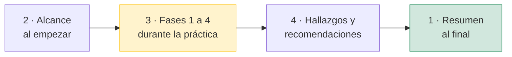

# Plantilla del informe · Laboratorio UD01 (LAB01 · DC-1)

**Módulo 5025 · Curso de Especialización en Ciberseguridad**

> **Cómo usarla.** El documentalista rellena esta plantilla **durante la sesión**, a medida que el
> equipo avanza. Sustituid lo que va entre `[corchetes]`. Al final solo queda escribir el resumen
> (apartado 1) y repasar. Un informe por equipo, entregado en Moodle.

---

## 1. Resumen (rellenar al final)

*Tres o cuatro frases para alguien sin perfil técnico: qué habéis auditado, qué habéis encontrado,
qué riesgo supone y qué tiene que hacer el cliente.*

[ ]

> **Ejemplo:** «Hemos auditado el servidor web de Drupalia. Hemos conseguido controlarlo por
> completo sin conocer ninguna contraseña porque su web usa un software sin actualizar. Un atacante
> podría robar o cambiar su información. Recomendamos actualizarlo cuanto antes.»

---

## 2. Datos y alcance (rellenar al empezar)

| Campo | Valor |
|---|---|
| Equipo | [ 3 ] |
| Operador / Investigador / Documentalista/ Revisor | [ ] / [ ] / [ ] / [ ] |
| Fecha | [ 19-11-2026 ] |
| IP de Kali | [10.0.1.10__] |
| IP de DC-1 (objetivo) | [10.0.1.12__] |
| Permitido | Solo la IP de DC-1: escaneo, análisis web, explotación y escalada |
| Prohibido | Cualquier otra IP, la red del centro, la denegación de servicio |
| ¿La IP de DC-1 está en `10.0.1.0/24`? | [**Sí** / No] |

---

## 3. Qué hemos hecho en cada fase

En cada fase, **antes de ejecutar** un comando, escribid en la columna «Qué esperamos» qué creéis
que va a pasar. Si no sabéis escribirlo, preguntad a la IA qué hace el comando antes de lanzarlo.

### Fase 1 · Reconocimiento: ¿qué máquina hay y qué servicios tiene?

> **Pregunta de ayuda para la IA:** «¿Cómo descubro qué equipos hay en mi red `10.0.1.0/24` y qué
> servicios tiene uno de ellos? Explícame qué hace cada opción del comando.»

| Comando | Qué esperamos | Qué ha salido (lo importante) | Captura |
|---|---|---|---|
| [ `nmap -sn 10.0.1.0/24` ] | [ Esperemos que escanee la red 10.0.1.0/24 y nos diga todas las IPs conectadas ] | [ Sale la IP de la maquina vulnerable 10.0.1.12 ] | [n.º1] |
| [ `nmap -sV -sC 10.0.1.12` ] | [ Esperamos que nos escanee los puertos abiertos, los servicios y las versiones de la IP ademas de las cabeceras ] | [ El puerto 22 ssh, el 80 con http con cabecera drupal7 y 111 con RCPbind ] | [n.º2] |

**Servicios encontrados:** [22 · ssh · Openssh 6.0p1 Debian 4+DEB7u7] [80 · shttp · Apachehttpd 2.2.22 (Debian)] [111 · RCPbind · 2-4]

**¿Qué servicio parece más interesante y por qué?** [ El servicio http es el mas importante debido a que esta abierto a internet y en un principio no tiene clave ]

### Fase 2 · Vulnerabilidades: ¿qué tiene un fallo conocido?

> **Pregunta de ayuda para la IA:** «He encontrado este servicio y esta versión: […]. ¿Cómo busco
> si tiene vulnerabilidades conocidas? ¿Qué es un CVE?»

| Comando o fuente consultada | Qué esperamos | Qué ha salido | Captura |
|---|---|---|---|
| [ msfconsole && search drupal7 ] | [ Esperamos obtener una vulnerabilidad de la cabecera drupal7 ] | [ Ha salido una vulnerabilidad conocida como drupalggedon una vulnerabilidad critica que permite la ejecución remota de código] | [n.º3] |

**Vulnerabilidad elegida (CVE) y qué permite hacer:** [ CVE-2014-3704 permite la ejecución remota de código ]

### Fase 3 · Explotación: ¿cómo conseguimos entrar?

> **Pregunta de ayuda para la IA:** «Quiero aprovechar esta vulnerabilidad: […]. ¿Qué herramienta
> se usa y qué significa cada opción que tengo que configurar?»

| Comando | Qué esperamos | Qué ha salido | Captura |
|---|---|---|---|
| [  ] | [  ] | [  ] | [n.º4] |

**¿Con qué usuario hemos entrado?** [ www-data ]
**¿Por qué no somos administradores todavía?** [ Por que deberemos de escalar de privilegios a traves de los comando que diremos en Posexplotación. ]

### Fase 4 · Posexplotación: ¿cómo llegamos a administrador?

> **Pregunta de ayuda para la IA:** «Tengo acceso como un usuario limitado en Linux. ¿Qué es
> escalar privilegios y qué debería revisar en el sistema?»

| Comando | Qué esperamos | Qué ha salido | Captura |
|---|---|---|---|
| [  ] | [  ] | [  ] | [n.º5] |

**¿Qué fallo de configuración nos ha permitido escalar?** [ ]
**Usuario final:** [ ]

> Si no llegáis a esta fase, escribid hasta dónde habéis llegado y qué probaríais después. Se
> valora lo que sabéis explicar, no llegar a root.

---

## 4. Hallazgos y recomendaciones

Un hallazgo es **un fallo del servidor**, no lo que habéis hecho vosotros. Una fila por fallo.

| Fallo encontrado | Por qué existe (causa) | Gravedad | Cómo corregirlo | Cómo detectar el ataque |
|---|---|---|---|---|
| [ drupal7 ] | [ El sitio utiliza una versión desactualizada de Drupal 7 que no valida ni sanea correctamente las claves de los arrays en las consultas SQL, permitiendo inyección SQL y ejecución remota de código.] | [**Crítica **_/ Alta / Media / Baja] | [ Actualizar el núcleo de Drupal a una versión segura/soportada y revisar que no existan usuarios o archivos maliciosos creados tras el compromiso. ] | [ Revisar los registros de acceso del servidor web (/var/log/apache2/access.log) en busca de peticiones POST sospechosas o payloads SQL inusuales, y monitorizar procesos hijos anómalos lanzados por el usuario ] |
| [ ] | [ ] | [ ] | [ ] | [ ] |

---

## 5. Uso de la IA

Cada integrante añade al menos una fila con su bitácora.

| Quién | Qué preguntamos | Qué aprendimos | ¿La IA se equivocó? ¿Cómo lo comprobamos? |
|---|---|---|---|
| [ ] | [ ] | [ ] | [ ] |
| [ ] | [ ] | [ ] | [ ] |
| [ ] | [ ] | [ ] | [ ] |

